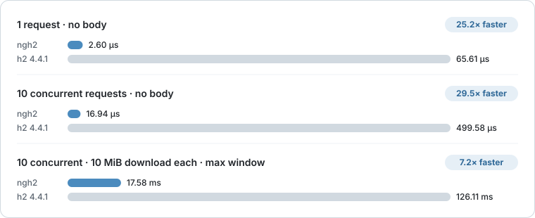

# ngh2

A fast Sans-I/O HTTP/2 library for Python.

Build HTTP/2 clients, servers, proxies, and protocol tools on the transport
and runtime you already use. ngh2 turns received bytes into events and your
calls into bytes to send; your code decides how and when those bytes move.

[Start the tutorial](learn/first-exchange.md){ .md-button .md-button--primary }
[Read the Python API](reference.md){ .md-button }

!!! warning "Alpha software"

    ngh2 is under active alpha development. Its public API may change before
    the first stable release.

## Why ngh2

### Fast

ngh2 completes HTTP/2 exchanges up to 30× faster than the pure-Python
[h2](https://h2.readthedocs.io/). Every measured scenario is listed below.

### Proven protocol engine

Framing, HPACK, flow control, and protocol validation come from
[libnghttp2](https://nghttp2.org/documentation/), the HTTP/2 implementation
behind curl, Node.js, and Apache httpd.

### Fits any runtime

ngh2 never opens sockets or starts an event loop, so the same code works with
asyncio, threads, Trio, or in-memory tests.

### Benchmark details

The chart shows three of the scenarios; the table lists all of them. Each
scenario runs complete HTTP/2 exchanges through the public APIs of ngh2 and h2,
measured with `pyperf`. Times are per iteration: one request, or ten
concurrent requests on one connection, with every response body read. Writes
are separate `send_data()` calls for one request body. Max window raises every
flow-control window to 2³¹−1, the protocol maximum; other scenarios keep the
65,535-byte default. Each library talks to itself in memory and reads its
peer's output in 64 KiB pieces. Work that h2 leaves to its caller, such as
splitting bodies to the window and acknowledging received data, is timed with
it.

--8<-- "python-benchmark.md"

These are protocol-layer measurements. They exclude sockets, TLS, event-loop
scheduling, and application work, so end-to-end gains depend on how much of
your program's time HTTP/2 processing takes.

[Benchmark source ↗](https://github.com/cnzakii/ngh2/blob/main/benchmarks/compare_h2.py) ·
[Raw `pyperf` result ↗](https://github.com/cnzakii/ngh2/blob/main/docs/assets/python-benchmark.json) ·
[Reproduce the measurements](contributing.md#performance-measurements)
